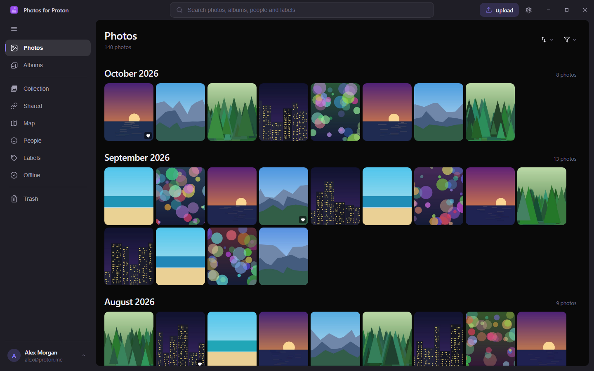
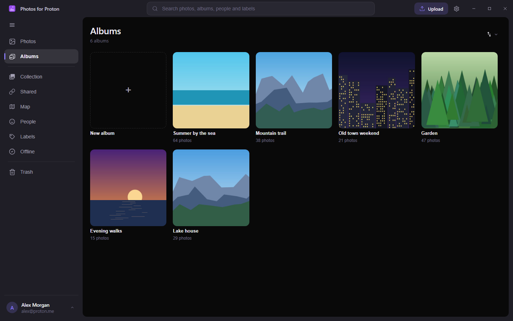

<p align="center">
  
</p>

<h1 align="center">Photos for Proton for Windows</h1>

<p align="center">
  End-to-end encrypted photo backup and browsing for your Proton Drive Photos library.<br />
  <strong>Unofficial</strong> open-source Windows client built on Proton's own Drive SDK by
  <a href="https://akoos.eu">Akoos</a>. Not affiliated with Proton AG.
</p>

<p align="center">
  <a href="https://github.com/gitakoos/photos-desktop/releases/latest"></a>
  <a href="https://github.com/gitakoos/photos-desktop/releases"></a>
  <a href="LICENSE"></a>
  
  <a href="https://www.photosforproton.eu"></a>
</p>

<p align="center">
  <a href="https://www.buymeacoffee.com/akoos"></a>
</p>

<p align="center">
  
  
</p>

## Features

| Area | What you get |
| --- | --- |
| **End-to-end encrypted** | Built on Proton's official Drive SDK, so photos and metadata are decrypted only on this device. Sign in on Proton's own page in the browser, where the password, the second factor and any captcha are entered, or with the password in the app. |
| **Browse & find** | The full timeline by month in a sidebar layout, with smooth zoom and a viewer that zooms around the cursor, a filmstrip and keyboard shortcuts. One search over photos, albums, people and labels, with dates, names, labels and categories as pills. A Collection of days and seasons from past years, and a map of where photos were taken with a searchable list of places. |
| **From your phone** | The people, the labels and the search index the Android app saves to Proton Drive, each on its own switch and kept up to date in the background. With the search index, photos are found by what they show ("dog in the snow"), matched on this PC. |
| **Albums & sharing** | Create, rename and delete albums, choose a cover, and add or remove photos. Share a photo by public link with an optional password and expiry, invite people to an album as viewer or editor, and accept or decline albums shared with you. |
| **Organize** | Rubber-band selection with bulk actions, right-click menus, favourites, renaming, and a trash that restores, deletes for good, or empties. |
| **Edit** | Crop, rotate, flip, adjust colour, apply filters and redact. Edits are saved as a new copy that keeps the original's date, camera and place. |
| **Upload & import** | Files, folders or drag and drop, with thumbnails, capture time, place and camera, and duplicates skipped. Import a Google Takeout or an Ente export with a review first; dates, places, albums, favourites and Live Photos are kept. |
| **File Explorer** | Optional. A Proton Photos folder in the Explorer sidebar that works both ways: copy photos in to upload them, make a folder under Albums for a new album, rename, move into Favorites, or delete to the Proton trash. Nothing takes space until it is opened, and Windows Search does not index the photos' dates, camera or places. |
| **Privacy & lock** | The session, the caches and any offline photos are sealed with AES-256-GCM on this PC, and locking discards the key. Lock when hidden in the tray, and keep photos available offline inside the app, readable by nothing else. |
| **Hardened** | No telemetry, logs scrubbed of key material, and updates checked against the release's SHA-256 before they run. |
| **Comfort** | Runs in the system tray and releases the renderer's memory there, starts with Windows if you like, updates itself with its progress shown, opens photos and videos from Explorer straight into the viewer, 11 languages, light, dark and system themes with a pure-black option, and 11 colour palettes. |

## Install

Download `Photos-for-Proton-Setup.exe` from the [releases page](https://github.com/gitakoos/photos-desktop/releases/latest) and run it. It installs for your account only and asks for no administrator rights. Windows SmartScreen may show "Windows protected your PC" the first time: choose **More info**, then **Run anyway**.

## Architecture

The app has three parts:

| Part | Holds | Talks to |
|---|---|---|
| **Host** | Tauri and Rust: windows, tray, the sealed store, the File Explorer folder (a Windows Cloud Filter provider), the updater launch | Frontend, Sidecar |
| **Frontend** | React: every screen, from the timeline to Settings | Host |
| **Sidecar** | Node with Proton's Drive TypeScript SDK: sign-in, the library, uploads, downloads, sharing, search | Host, over JSON-RPC on stdin and stdout |

The installer in `setup/` is a second, smaller Tauri app that carries the whole application as an embedded payload.

## Project structure

```
app/
├── src/              Frontend (React)
│   ├── views/        Photos, Albums, Shared, Trash, Settings, Lock, tray popup, viewer window
│   ├── components/   Grid, viewer, editor, map, upload, sidebar, dialogs
│   ├── hooks/        Thumbnails, uploads, selection, cloud and folder media
│   ├── lib/          RPC, search terms, dates, geocoder, theme, i18n, locales (11 languages)
│   └── styles/       One stylesheet per screen
└── src-tauri/src/    Host (Rust)
    ├── lib.rs                       Windows, tray, commands, the sidecar channel
    ├── cloud_mount.rs               File Explorer folder (Cloud Filter provider)
    ├── explorer_sync.rs, explorer_rules.rs   Changes made in Explorer, read and applied
    ├── secure_store.rs              Sealed store and the vault key
    └── window_place.rs, notices.rs, file_assoc.rs, autostart.rs, …
sidecar/
├── server.ts         JSON-RPC server
├── update.ts         Release check and verified download
└── proton/           Session, library, upload, download, albums, sharing,
                      trash, import, search, the phone's saved data
setup/                Installer (Tauri)
```

## What's reused vs. what's built here

This project **uses Proton's published Drive SDK as-is** (no forks, no modifications). Requests carry a client-specific app version so Proton's servers see this independent client for what it is, rather than impersonating an official app. Everything around it, the host, the screens and the File Explorer folder, is written for this project.

The app does not emit any telemetry events; there is no analytics call site anywhere in the code.

## Disclaimer

Not affiliated with Proton AG. Proton, Proton Drive, and Proton Photos are trademarks of Proton AG. Built on Proton's published Drive SDK with no proprietary code from Proton.

## Author

[**Akoos**](https://akoos.eu): creator and maintainer.

## License

[GPL-3.0](LICENSE). Third-party licences and notices are in [THIRD-PARTY-NOTICES.txt](THIRD-PARTY-NOTICES.txt), installed alongside the app.
